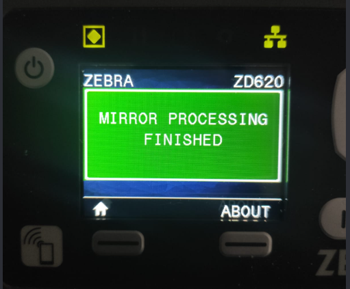

## Link-OSプリンタ_Mirror環境をDockerで構築する
### ◇ Zebra-Printer_Create Mirror by Docker Container

Update 2026/10/10




<br/>

ネットワーク接続されたLink-OSプリンタを手軽に設定や更新をしたいときに便利なのが、Mirror機能です。特に不特定多数のプリンタに対して変更が必要なときに重宝する機能です。
<br/>

- トレーニング・デモ用機器の設定
- 導入前の自動設定
- ファームウェアの自動更新
<br/>

MirrorサーバであるSFTP環境構築にはサーバの手配であったり、基礎的なサーバやネットワークが知識が必要で構築が難しいというお声もあります。

そのような方向けに本頁ではより容易に構築できるようにDockerのひな型と簡易的な構築手順をご案内します。

尚、本頁はDockerやVSCODEの初歩的な知識と経験がある方向けの解説となっております。
<br/>

---
### ◇ 目次
- [Link-OSプリンタ\_Mirror環境をDockerで構築する](#link-osプリンタ_mirror環境をdockerで構築する)
  - [◇ Zebra-Printer\_Create Mirror by Docker Container](#-zebra-printer_create-mirror-by-docker-container)
  - [◇ 目次](#-目次)
  - [◇ Windows / Docker Desktopを用いる方法](#-windows--docker-desktopを用いる方法)
    - [◆ 前提条件](#-前提条件)
    - [◆ 手順](#-手順)
  - [◇ Debian(Linux) / Docker を用いる方法](#-debianlinux--docker-を用いる方法)
    - [◆ 前提条件](#-前提条件-1)
    - [◆ 手順](#-手順-1)


<br/>
<br/>

---
### ◇ Windows / Docker Desktopを用いる方法

#### ◆ 前提条件

1. Windows 11 Pro 環境を前提
2. Docker Desktopがインストールされていること
3. VSCODEがインストールされていること
4. Docker関係のVSCODEの拡張機能がインストールされていること
   1. MS container tools
   2. MS Docker
   3. MS Dev containers
   4. MS Remote ssh
   5. MS Remote Explorer
<br/>
    <br/>

#### ◆ 手順

1. win11_docker-desktopの内容を任意の場所にコピーします。
2. sftp_mirror_01 に移動します。
   ```
   cd sftp_mirror_01
   ```
    <br/>

1. dockerサービスを開始します。
   
   ```
   sftp_mirror_01> docker compose up -d
    [+] up 2/2
    ✔ Network sftp_mirror_01_default Created                                                                           0.0s
    ✔ Container sftp_mirror_01       Started                                                                           0.4s
   ```
    <br/>

1. sftpでログイン確認します。
   - login zebra
   - pass: zebra

    ```
    sftp_mirror_01> sftp zebra@localhost
    The authenticity of host 'localhost (::1)' can't be established.
    ED25519 key fingerprint is SHA256:+Cs31HXkVmKQnYRdvhH9prKsLr/72No705tJr8SP5a4.
    This key is not known by any other names.
    Are you sure you want to continue connecting (yes/no/[fingerprint])?
    Warning: Permanently added 'localhost' (ED25519) to the list of known hosts.
    zebra@localhost's password:zebra
    Connected to localhost.
    sftp>
    ```
    <br/>

1. プリンタのMirror/Sftp設定をし、自動更新を確認する。
   
   [Programinng Guide：Mirror 1699ページ参照](https://docs.zebra.com/us/en/printers/software/zpl-pg/c-zpl-mirror-mirror/c-zpl-mirror-configuration/r-zpl-mirror-mirror-printer-configuration.html)

<br/>
<br/>

---

### ◇ Debian(Linux) / Docker を用いる方法

#### ◆ 前提条件

1. Debian系Linux(6.12) 環境を前提
2. Dockerがインストールされていること
3. VSCODEがインストールされていること
4. Docker関係のVSCODEの拡張機能がインストールされていること
   1. MS container tools
   2. MS Docker
   3. MS Dev containers
   4. MS Remote ssh
   5. MS Remote Explorer
<br/>

#### ◆ 手順

1. debianの内容を任意の場所にコピーします。
2. sftp_mirror_01 に移動します。
   ```
   cd sftp_mirror_01
   ```
1. dockerサービスを開始します。
   
   ```
    docker@nuc01:~/workspace/sftp-server-01$ docker compose up -d 
    [+] up 1/1
    ✔ Container sftp_mirror_01 Started   
    ```
    <br/>

1. sftpでログイン確認します。
   - login zebra
   - pass: zebra

    ```
    docker@nuc01:~/workspace/sftp-server-01$ sftp zebra@192.168.4.225 
    The authenticity of host '192.168.4.225 (192.168.4.225)' can't be established.
    ED25519 key fingerprint is SHA256:3Ze3xy8+s31UFLyLgw9lvefZ283y2EYA1Er7k9+Zpl8.
    This key is not known by any other names.
    Are you sure you want to continue connecting (yes/no/[fingerprint])? yes
    Warning: Permanently added '192.168.4.225' (ED25519) to the list of known hosts.
    zebra@192.168.4.225's password: zebra
    Connected to 192.168.4.225.
    sftp> 
    sftp zebra@localhost
    ```
    <br/>

1. プリンタのMirror/Sftp設定をし、自動更新を確認する。
   
   [Programinng Guide：Mirror 1699ページ参照](https://docs.zebra.com/us/en/printers/software/zpl-pg/c-zpl-mirror-mirror/c-zpl-mirror-configuration/r-zpl-mirror-mirror-printer-configuration.html)

